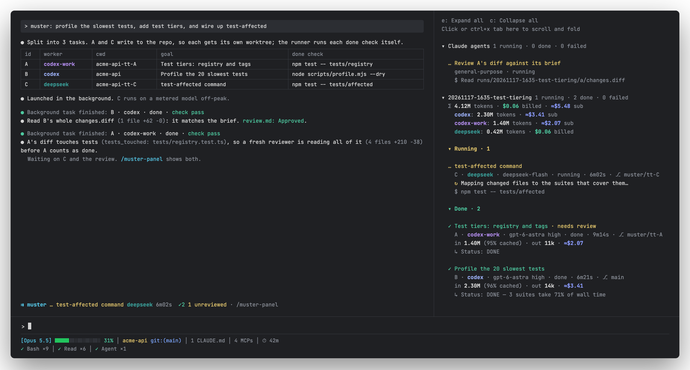

<div align="center">


# Muster

**One Claude Code session. A crew of CLI agents working in parallel. Every task's progress, tokens and cost in a live pane.**

[](https://github.com/jandyx/muster/actions/workflows/ci.yml)
[](LICENSE)
[](https://github.com/anthropics/claude-code)
[](https://www.python.org/)
[](#configure)

[Quick start](#quick-start) · [Agent setup](#set-up-with-any-coding-agent) · [Configure](#configure) · [The pane](#the-pane) · [Tokens and cost](#tokens-and-cost) · [How it works](docs/how-it-works.md) · [FAQ](#faq)

</div>

---

You talk to one Claude Code session. Claude splits the job, hands each piece to a worker (a Codex account, Claude Code on another backend such as DeepSeek), checks what comes back, and reports. Muster gives that loop a fixed shape so you stop re-explaining it every session, and puts a pane beside the chat that shows what every worker is doing right now and what it has cost.

<p align="center"></p>

<details>
<summary>The same pane as text</summary>

```text
▾ Claude agents 1 running · 0 done · 0 failed

  … Review A's diff against its brief
    general-purpose · running
    $ Read runs/20261117-1635-test-tiering/a/changes.diff

▾ 20261117-1635-test-tiering 1 running · 1 done · 0 failed · 1 needs review
  Σ 4.12M tokens · $0.06 billed · ≈$5.48 sub
    codex: 2.30M tokens · ≈$3.41 sub
    codex-work: 1.40M tokens · ≈$2.07 sub
    deepseek: 0.42M tokens · $0.06 billed

  ▾ Running · 1

  … test-affected command
    C · deepseek · deepseek-flash · running · 6m02s · ⎇ muster/tt-C
    ↻ Mapping changed files to the suites that cover them…
    $ npm test -- tests/affected

  ▾ Needs review · 1

  ? Test tiers: registry and tags · needs review
    A · codex-work · gpt-6-astra high · needs review · 9m14s · ⎇ muster/tt-A
    in 1.40M (95% cached) · out 11k · ≈$2.07
    ↳ Status: DONE
```

</details>

## Why Muster

Claude Code is a good planner and a careful reviewer. Codex accounts and cheaper Claude-compatible backends are good at grinding through well-scoped work. Running them together by hand means repeating the same instructions every session (which account takes which repo, how to isolate parallel edits, what to report) and switching terminals to see who is stuck.

Muster turns that into a habit Claude already knows and a screen you can glance at:

| | Without Muster | With Muster |
|---|---|---|
| Starting a batch | explain workers, accounts and rules again | say "muster: …" |
| Parallel edits to one repo | hope they don't collide | one git worktree per task, automatically |
| "Is it done? Is it stuck?" | switch terminals, read logs | live pane: latest note, latest command, stall warning |
| "What did that cost?" | guess | tokens and dollars per task, per worker, per run |
| Trusting the result | take the worker's "tests pass" | the runner runs the done check and records exactly what changed; Claude reads the whole diff, and the pane marks what nobody reviewed |

## Features

- **A `muster` skill.** Plan → isolate → self-contained prompts → launch in the background → run the done check itself (`--check`) → review the whole diff (`changes.diff`, written by the runner) into `review.md`; the pane marks unreviewed tasks → one report table. The same loop every time.
- **Any number of workers.** Each Codex account is a `codex` worker with its own `CODEX_HOME`; any Claude Code compatible CLI is a `claude` worker; the Antigravity CLI (`agy`, Gemini) is an `agy` worker. Several tasks can run on one account at once.
- **Routing you write once.** Per-repo worker priority with quota fallbacks, workers fenced to certain repos, parallel caps. The fences and caps are enforced by the runner, not left to Claude's memory.
- **Evidence, not claims.** Around each task the runner snapshots the repo and writes `changes.diff` with only that worker's changes, runs the done check itself (`--check`), and flags edits to tests (`tests_touched`) and other tasks in the same repo (`shared_with`). Claude reviews against the brief and records `review.md`.
- **A live pane and band.** Task title, worker, the model it runs on, elapsed time, the worker's latest note and command, a red warning after 2 minutes of silence, the done check while it runs, a one-line result, separate `Needs review` and `Needs fixes` sections so only accepted work counts as Done, foldable runs — and the session's own Claude subagents, running first, finished ones folded.
- **Honest cost accounting.** Billed `$` for metered APIs, with DeepSeek's peak-hour price; API-equivalent `≈$` for Codex on a ChatGPT subscription; long-context pricing per request.
- **Session-bound.** A session sees only the runs it started; `claude --resume` brings them back.
- **Stall reports.** `muster.py watch <run-dir>` wakes Claude when a running worker has been silent for 10 minutes (`--stall-min N`), once per silence. It only reports: Claude decides whether to wait, cancel or relaunch.
- **A clean-up list.** `muster.py clean` lists old runs, task worktrees and `muster/*` branches, merged or not, with the command for each; it deletes nothing.
- **No dependencies.** The runner is one Python file on the standard library.

## Quick start

**1. Install the plugin**

```text
/plugin marketplace add jandyx/muster
/plugin install muster@muster
```

**2. Let Claude set up your workers**

> set up muster

The `muster-setup` skill finds your Codex logins and Claude-compatible CLIs, asks which repos each one should take, writes `~/.muster/config.json` and checks it with `muster.py doctor`.

<details>
<summary>Or write the config by hand</summary>

```bash
mkdir -p ~/.muster
curl -fsSL https://raw.githubusercontent.com/jandyx/muster/main/examples/config.example.json -o ~/.muster/config.json
$EDITOR ~/.muster/config.json
python3 <plugin>/skills/muster/muster.py doctor
```

</details>

**3. Hand Claude a batch**

> muster: profile the slowest tests, audit the serial test group, and draft a tiering plan

Claude shows the plan table and starts, and the pane opens beside the chat. Reopen it any time with `/muster-panel`.

<details>
<summary>Install from a clone instead (runs straight from the folder; edit, then <code>/reload-plugins</code>)</summary>

```bash
git clone https://github.com/jandyx/muster ~/workspace/muster
claude plugin marketplace add ~/workspace/muster
claude plugin install muster@muster --scope user
```

</details>

### Set up with any coding agent

Paste this into Claude Code (or another agent with a shell) and it does the whole install:

```text
Install and configure Muster (https://github.com/jandyx/muster) for me:
1. Run: claude plugin marketplace add jandyx/muster && claude plugin install muster@muster --scope user
2. Run: python3 ~/.claude/plugins/marketplaces/muster/skills/muster/muster.py detect
   (if that path does not exist, find muster.py under ~/.claude/plugins)
3. Follow skills/muster-setup/SKILL.md from that repo: propose workers from what detect found,
   ask me only which repos each worker takes, write ~/.muster/config.json, then run muster.py doctor until it says ok.
4. Never print auth files or API keys. Tell me to run /reload-plugins when done.
```

**Requirements:** Claude Code with plugin support, Python 3.10+, and the worker CLIs you use (`codex`, `claude`, a Claude-compatible wrapper, or `agy`).

## Configure

`~/.muster/config.json` (set `MUSTER_CONFIG` to use another path):

```jsonc
{
  "runsDir": "~/.muster/runs",                 // where every run is recorded
  "workers": {
    "codex":      { "type": "codex",  "codexHome": "~/.codex" },
    "codex-work": { "type": "codex",  "codexHome": "~/.codex-homes/work", "args": ["-m", "gpt-6-astra"] },
    "deepseek":   { "type": "claude", "command": "~/.local/bin/deepseek-claude",
                    "args": ["--dangerously-skip-permissions"], "billing": "metered" }
  },
  "routing": [                                  // first match on the task's cwd wins
    { "match": "~/workspace/work-*", "workers": ["codex-work", "codex", "deepseek"],
      "preamble": ["Open pull requests with the repo's pr.sh."],     // added to prompts for these repos only
      "tiers": { "high": { "when": "Anything that touches billing/." } } },   // these repos' rule for a tier
    { "match": "*",                  "workers": ["codex", "deepseek"] }
  ],
  "only":  { "codex-work": ["~/workspace/work-*"] },   // this worker refuses any other repo
  "caps":  { "codex": 3, "claude": 5, "agy": 3 },     // tasks at once per worker (by type or by name)
  "tiers": {                                         // optional: one setting per task, cheapest that suffices
    "low":      { "prefer": ["deepseek"], "args": { "codex": ["-c", "model_reasoning_effort=\"medium\""] } },
    "standard": { "args": { "codex": ["-c", "model_reasoning_effort=\"high\""] } },
    "high":     { "args": { "codex": ["-c", "model_reasoning_effort=\"xhigh\""] },
                  "when": "Cross-module work, concurrency, security or data migrations." }   // optional: replaces the skill's rule
  },
  "preamble": ["Never print secrets or tokens in your output."]
}
```

**Tiers** are optional; without them every task runs with its worker's own settings. `low`, `standard` and `high` are the only names, each with up to three keys:

- `args`: extra CLI arguments by worker name or type (`codex`, `claude`, `agy`), added after the worker's own `args`. When both keys fit a worker, only the name's list is used; the two are not merged. Change the model with `["--model", "opus"]` for Claude Code, `["--model", "gemini-4-neon-high"]` for agy (`agy models` lists them), or `["-c", "model=\"<model>\""]` for Codex. Codex refuses `-m` twice, and `doctor` flags a tier that adds `-m` to a worker that already sets it.
- `prefer`: workers that take the task first when several have a free slot.
- `when`: one sentence that replaces the skill's rule for picking this tier. A `routing` entry's `tiers.<name>.when` replaces it for those repos.

Claude picks each task's tier; the runner applies `prefer` and `args`. `stats` shows how each tier did (see [How the tiers perform](#how-the-tiers-perform)). Asking `muster-setup` in plain words ("high uses opus", "low goes to deepseek") writes these keys for you.

`//` comments are allowed, and `doctor` ignores keys starting with `_` at the top level, in a worker, in a `routing` entry and in a tier, so they can hold notes. Check it with `python3 <plugin>/skills/muster/muster.py doctor` (one line per problem, `ok` when usable: broken JSON with its line, unknown keys such as a misspelled `preambel`, wrong types, unknown workers), list workers with `workers`, and see what the machine offers with `detect`.

<details>
<summary>Worker types</summary>

| Type | Runs | Live progress from | Usage from |
|---|---|---|---|
| `codex` | `codex exec --dangerously-bypass-approvals-and-sandbox` with `CODEX_HOME=codexHome` | the agent's notes and `exec` lines in `log.txt` | the session rollout in `codexHome/sessions/` |
| `claude` | `<command> -p --output-format stream-json --verbose <args>` | the last text and tool call in `stream.jsonl` | the final `result` event's `modelUsage` |
| `agy` | `<command> --output-format stream-json --dangerously-skip-permissions <args> --print=<prompt>` (agy reads no stdin, so the prompt is an argument) | the last text and tool call in `stream.jsonl` | the final `result` event's `usage`; the model is the `--model` in `args`, and `billing` defaults to `subscription` |

</details>

<details>
<summary>What Claude follows vs. what the runner enforces</summary>

| Setting | Claude, when planning | `muster.py`, when launching |
|---|---|---|
| `routing` | picks workers in that order, falls back on quota errors | not checked |
| `only` | never plans a fenced worker elsewhere | refuses outside its globs (exit 3) |
| `caps` | passes each task its whole worker list | queues while every listed worker is full, starts on the first to free a slot (priority, then launch order); counts live processes only |
| `tiers` | picks each task's tier by its `when` (the matching `routing` entry's first) or the skill's default rule, and passes `--tier` | moves `prefer` workers to the front of the task's list (after `only` has filtered it), so they win when several have a free slot; appends the tier's `args` after the worker's own |
| `preamble` | adds the lines to every prompt, then the first matching `routing` entry's `preamble` | only its shape (`doctor`) |
| `--check` | writes a done check for each task and passes it | runs it after the worker, one at a time per `runsDir`; a failing check fails the task |

When a worker fails, `status` reads `failed: <reason>`: the last error line of its log (secrets such as `sk-…` or `Bearer …` masked, cut to 160 characters), or `exit <code>` when there is none. `meta` keeps it as `last_error`, with the log's path as `log_path`, and the pane shows both. A worker that ran out of disk shows `failed: disk full (ENOSPC), …` and its `result.md` ends with the command to rerun it. A worker that exits 0 but opens its report with `Status: BLOCKED` or `Status: NEEDS_CONTEXT` shows `failed: worker reported BLOCKED` (or `NEEDS_CONTEXT`): its done check is skipped and tasks waiting on it with `--after` are canceled. A failed task records `failure=provider` when the worker's own error line names a provider problem (usage limit, quota, rate limit, too many requests, HTTP 429/401/403/529, overloaded, billing, credits, access token, unauthorized, authentication, `codex_login`, `RESOURCE_EXHAUSTED`). Retry on another worker at the same tier. Any other non-zero worker exit (disk full, a dropped connection, a server error, a crash) records `failure=infra`, and a runner stopped by an outside signal records `failure=interrupted`: retry both at the same tier on the same or another worker. After two such failures in a row on one piece of work, Claude stops and asks instead of rerunning again; a context or turn limit counts as the task's failure. A `BLOCKED` or `NEEDS_CONTEXT` report records `failure=blocked`: answer it or split the task; a stronger tier does not help. A failed done check records `failure=task`. Canceled tasks have no `failure` key.

</details>

### How settings combine

Your words in the conversation win over the config ("run this on deepseek", "make it high"), except for the limits the runner enforces. For one task, in order:

| Step | Rule | Who |
|---|---|---|
| Config file | `MUSTER_CONFIG` if set, else `~/.muster/config.json` | both |
| Candidate workers | the workers you name; otherwise the **first** `routing` entry whose `match` fits the cwd, so put narrow globs (`~/work/app-ios*`) above broad ones (`~/work/app-*`) and `*` last | Claude |
| Fences | `only` removes workers fenced away from the cwd, even ones you named; none left is a refusal (exit 3) | runner |
| Tier | the tier you name; otherwise the matching `routing` entry's `tiers.<name>.when`, then `tiers.<name>.when`, then the skill's default rule | Claude |
| Order | the tier's `prefer` moves listed workers to the front; it never adds a worker | runner |
| Start | the first listed worker under its cap takes the task; `caps.<name>` wins over `caps.<type>`, default 3 for `codex` and `agy` and 5 for `claude`; on a full worker, higher `--priority` starts first, then launch order | runner |
| Arguments | later wins: the CLI's own settings (a Codex home's `config.toml`, a wrapper's defaults), then the worker's `args`, then the tier's `args`. Codex refuses `-m` twice, so `doctor` flags it | runner |
| Prompt rules | added, never replaced: global `preamble`, then the matching `routing` entry's `preamble`, then repo rules from your own instructions, which Claude copies into the brief | Claude |
| Prices | `~/.muster/prices.json` replaces the plugin's `prices.json` model by model | runner |

Example, with the config above: a `low` task in `~/workspace/work-app` matches the first `routing` entry (`codex-work`, `codex`, `deepseek`); `only` keeps all three; `low` moves `deepseek` to the front. It starts on `deepseek` when that has a free slot, otherwise on the first Codex worker with one; on `codex-work` that means `-m gpt-6-astra` from its own `args` plus `low`'s reasoning effort. Its prompt carries the global `preamble` and the entry's pull-request line.

## The pane

The pane opens by itself when a prompt starts with `muster:` or `/muster`. `/muster-panel` opens it and gives it the keyboard. While tasks run or wait for review, a one-line band above the prompt counts them across runs, most urgent first, behind a progress bar that fills only with accepted work. A rerun launched with `--retry-of <task-dir>` is the same piece of work as the attempt it names, even under another id or in another run, and its newest attempt decides, as with a CI retry; older tasks fall back to `x`, `x-r2`, `x-r3` inside one run. Canceled work leaves the total. A task's own percentage comes only from a `Progress: 12/40` or `Progress: 45%` line its worker prints.

Above the runs, **Claude agents** lists the subagents this Claude Code session spawned — the Agent tool's, including plugin agents such as `oh-my-claudecode:executor-high`. Running and waiting ones show with their status and, while they work, their latest tool call (`$ …`); finished ones fold into a count. The engine supplies the list (`$.agent.list()`), so they carry no worker, tokens or cost.

| Key | Does |
|---|---|
| `/muster-panel` | open and focus the pane |
| `ctrl+x`, then `tab` | move focus between the band and the pane |
| `↑` `↓` | scroll |
| `tab` · `enter` | move between runs · fold or unfold one |
| `e` · `c` | expand all · collapse all |
| `esc` | back to the prompt |

Inside a run, tasks are grouped as Running, Queued, Failed, Needs fixes, Needs review, Canceled and Done; earlier attempts of reworked tasks fold under Retried. A task that changed nothing counts as a finished read-only review once `review.md` covers it, whatever its verdict. Done holds only reviewed work (and older tasks with no recorded diff); the `status` file still says `done` for the others, because the worker and its check succeeded. When a run has stopped working and tasks in it still wait for review or fixes, the session that dispatched it is sent back once per task at the end of its turn; a closed session is not reopened.

At the top, **To decide** lists what only you can settle, in your language: a question Claude wrote into the task's `decision.md`, with what each option leads to and which it recommends. Picking an option sends it to Claude as your answer; **Other…** only fills the prompt box for your own. Reviewed work is not listed: Claude merges an approved task's `muster/*` branch into the branch it started from on its own, resolving conflicts itself, and records `Merged:` in `review.md`. The band shows `⚖️ N to decide` while anything waits there, even after its run has finished.

Finished runs fold to one line with their totals; a run with work left to review or fix stays open. A toast tells you when a task ends. Each worker keeps one color everywhere, and each task names the model it ran on (with its reasoning effort for Codex).

### Open stats in Claude Code

`/muster-stats` opens with Overview focused. Press Tab or Shift+Tab to move through Overview, Repos, Workers and the date ranges. Each selection takes effect immediately. Use ↑/↓ to scroll one row at a time, Page Down to see the next page, and Esc to return to the prompt. The command runs `muster.py stats --json` once and also returns the overview as text, including in sessions without panes.

## Tokens and cost

- **Metered workers** (an API key, DeepSeek) show billed dollars in green, marked `peak` when they started in DeepSeek's peak hours (weekdays 01:00–04:00 and 06:00–10:00 UTC, double price). The skill warns before sending a large, non-urgent batch into peak hours.
- **Subscription workers** (Codex on a ChatGPT login) show `≈$`: what the same tokens would cost on the API. You are not billed per token.
- **Codex is priced per request**, so requests past the long-context threshold use the long-context rate.
- **Prices** live in [`prices.json`](prices.json) with their source and date. Override any model in `~/.muster/prices.json`. `python3 scripts/update_prices.py [model …]` refreshes them from LiteLLM's community price list, the one ccusage uses, and adds the models you name.

The full decision chain is drawn in [docs/how-it-works.md](docs/how-it-works.md#how-a-tasks-cost-is-worked-out).

## How the tiers perform

`python3 <plugin>/skills/muster/muster.py stats [--days N] [--since D] [--until D] [--by FIELDS]` reports on run history in read-only mode. Retries linked with `--retry-of` or named `x`, `x-r2` belong to one piece of work. Canceled attempts and attempts that never started are ignored.

`stats --json` writes the data for `/muster-stats` to standard output. The heatmap covers the history loaded with `--days`, `--since` and `--until`. The pane's date range selects which metrics and table rows to show.

Use `--by repo,type` to compare worker types within each repository. Choose a comma-separated list from `repo`, `type`, `tier`, `worker` and `model`. These fields appear first, in the order given, and come from the first counted attempt. The default is `tier,worker,model`.

`--since` and `--until` filter by the first counted attempt's start time. Both take `YYYY-MM-DD` or a quoted `"YYYY-MM-DD HH:MM"`. `--since` includes its boundary. A date-only `--until` includes the whole day. An `--until` with a time keeps only work started before that time. Work without a recorded start time is excluded from a date window. Combine either bound with `--days N` to limit run folders by the date in their names.

`repo` uses the main checkout's directory name. New runs record its path in `main_repo` when Git can resolve it. For older runs, Muster finds the main checkout from Git's common directory at the recorded `repo` (or `cwd`). For a deleted worktree named `<repo>-<suffix>`, it uses the longest matching repo name resolved in the same report. With no match it keeps the directory name, and with no recorded path it shows `-`.

The newest counted attempt determines the outcome. If it is `done` and its metadata has no `changes` key, the work predates recorded reviews. The footer counts these exclusions. Every group with settled or open work gets a tab-separated row.

| Column | Means |
|---|---|
| Selected `--by` fields | where the work started, with `-` for missing values. `type` uses the recorded worker type or the worker's configured type |
| `settled` | accepted work plus work whose newest counted attempt failed |
| `accepted` | settled work whose current diff has an `Approved` or `User override` verdict, or a `Needs fixes` verdict on an empty diff, and whose status is `done` |
| `open` | running work, completed work awaiting a current review or a requested fix, or work waiting for a rerun after a provider, infra or interruption failure |
| `first_pass` | share of accepted work that needed no rework, including fixes by Claude, and had no `Fixed in:` line, or `-` |
| `attempts_per_work` | mean attempts per settled piece, excluding provider and infra failures and interruptions |
| `blocked` | settled pieces with at least one attempt marked blocked after the worker reported `BLOCKED` or `NEEDS_CONTEXT` |
| `check_failed` | settled pieces with at least one failed done check |
| `needs_fixes` | settled pieces where an attempt's last verdict was `Needs fixes` on a non-empty diff, or the newest attempt's review has a `Fixed in:` line |
| `claude_fixed` | settled pieces with a `Fixed by: Claude: <what changed>` line in any counted attempt's review. Claude records this when it patches the worker's diff before approval |
| `outside_failures` | number of provider failures, infra failures and interruptions, counting each attempt across both settled and open work |
| `median_minutes` | median minutes per settled piece, summing recorded attempt durations for each piece |
| `tokens_per_accepted` | input plus output tokens across settled work, divided by the accepted count |
| `usd_per_accepted` | recorded cost across settled work divided by the accepted count, with `≥` when only some attempts have a price and `-` when none do |
| `billing` | `metered`, `subscription` or `mixed` across settled attempts, or `-` when unknown |

A settled piece can count in more than one failure column, even if a later attempt was accepted. A row with only open work shows `-` for all rates, costs, timing and billing. Work whose newest attempt failed for a provider, infra or interruption reason is open: it waits for its rerun. Work accepted after an escalation stays in its starting row, so `first_pass` shows how often the starting tier was enough. A failed attempt on settled work contributes its cost, including provider and infra failures and interruptions. Subscription dollars express the API-equivalent cost. With fewer than 30 settled pieces, only large differences are meaningful.

## How it works

Claude runs the `muster` skill, which calls `muster.py` once per task in the background. `muster.py` checks the fences and caps, starts the worker, writes everything under `runsDir`, and prices the usage when the worker exits. The pane reads those files every 5 seconds, and asks the engine for the session's own subagents on the same poll.

Architecture, a run's sequence, a task's states and what each pane row reads are drawn in **[docs/how-it-works.md](docs/how-it-works.md)**. Why it is built this way is in **[docs/design.md](docs/design.md)**; **[docs/](docs/README.md)** indexes all of it.

<details>
<summary>Where things are kept</summary>

| What | Where | Size, roughly |
|---|---|---|
| Runs: prompts, status, logs, results, usage, `changes.diff`, `check.txt`, `review.md` | `runsDir` (`~/.muster/runs`) | 1–3 MB per run; `log.txt` is the bulk |
| Worker transcripts | each CLI's own folder (`codexHome/sessions`, the Claude profile's `projects`) | owned by those tools |
| Worktrees for parallel writers | next to the repo, branch `muster/<task>` | a full checkout each |

Muster deletes nothing on its own. `python3 <plugin>/skills/muster/muster.py clean [--days N]` lists what could go: runs untouched for N days (default 14), task worktrees and `muster/*` branches, each marked merged or not (rebased and cherry-picked work counts as merged) and with uncommitted changes counted, next to the command that would remove it. You run the ones you choose.

</details>

## Safety

> [!WARNING]
> Workers run with approvals and sandboxing off (`agy` workers with `--dangerously-skip-permissions`): they can run any command in the folder you give them. An `agy` worker gets its prompt as a command-line argument, so other local users can read it in the process list. Use Muster in repos you trust, keep secrets out of prompts, and read the diffs before merging. Claude merges an approved task's `muster/*` worktree branch into the local branch it was made from without asking, committing the worker's leftover changes on that branch first and stashing your uncommitted edits around the merge if git needs it; it never pushes, force-pushes or opens a pull request unless you ask. `muster.py cancel` sends SIGTERM only to the runner pid in that task's `meta`, and only while that task is queued or running. Around each task the runner snapshots the cwd's repo with `git add -A` into a throwaway copy of the index and `git write-tree`, before and after, to write `changes.diff`: that adds objects to the repo's `.git` (unreferenced, so git's automatic gc removes them once they are about two weeks old; with Git LFS, `git add` also copies tracked large files into `.git/lfs/objects`), but never touches the real index, a branch or a working file. `--check` runs the given command in the cwd with `sh -c`, with the same rights as the worker, one check at a time per `runsDir`, and is skipped when the worker reports `BLOCKED` or `NEEDS_CONTEXT`; `muster.py watch` only reads a run and records in each task's `meta` which silence it has reported, and never stops a task; stopping a task stops every process its worker or check started. The runner does not merge and does not police merges: the pane keeps each finished task out of Done, under `Needs review` or `Needs fixes`, until its `review.md` approves the current `changes.diff`; use your repo's branch protection if merges need a hard gate.

Before dispatch, the runner checks quota by reading the newest rollout in each candidate Codex home's `sessions/` directory. It opens session files read-only. When any worker, whatever its type, fails on a usage limit, quota, rate limit, HTTP 429 or `RESOURCE_EXHAUSTED`, the runner records it in `<runsDir>/.quota.json` until the time the error names (for Codex, the rollout's reset time; otherwise 30 minutes for a spent quota or usage limit, 2 minutes for a plain rate limit, 429, `RESOURCE_EXHAUSTED` or a per-minute quota), so tasks start on the next listed worker in the meantime.

## FAQ

<details>
<summary><b>Does it work with oh-my-codex or other Codex wrappers?</b></summary>

Workers run plain `codex exec`, which still loads the worker's `codexHome` (its `AGENTS.md`, config and skills). Runtime hooks that a wrapper adds around interactive sessions do not run.

</details>

<details>
<summary><b>Can I use it without Codex?</b></summary>

Yes. Configure only `claude` workers (Claude Code on another backend, or any CLI that accepts `-p --output-format stream-json`) or `agy` workers (Gemini through the Antigravity CLI; sign in once by running `agy`).

</details>

<details>
<summary><b>Why is a task "failed: refused"?</b></summary>

The runner stopped it before it started: exit 3 means every worker it was given is fenced away from that repo (`only`). A worker at its parallel cap (`caps`) does not refuse; the task shows `queued` until a slot frees.

</details>

<details>
<summary><b>A task shows "canceled", "failed: lost" or "failed: interrupted".</b></summary>

`canceled`: Claude stopped it on purpose with `muster.py cancel` (superseded, no longer needed), or a task it runs `--after` failed; not counted as a failure. `interrupted`: the runner was told to stop (SIGTERM, SIGHUP, Ctrl-C); it stopped the worker and recorded that. `lost`: the runner process is gone without writing a final status (killed with SIGKILL, a crash, a reboot), so the pane marks it instead of showing a `running` that never ends. Read the task's `log.txt` or `stream.jsonl` for what the worker got done. Editing `muster.py` while tasks run is safe: Python reads the whole file at start.

</details>

<details>
<summary><b>What does "needs review" mean?</b></summary>

The task finished, but nobody has approved its `changes.diff` yet, so it does not count as Done. It clears when `review.md` in the task folder has `Verdict: Approved` and the `changes_sha256` from `meta`, so a review of an older diff does not count. `needs fixes` means a review of the current diff ended in `Verdict: Needs fixes`. Claude merges only approved tasks; the pane shows what was taken on trust.

</details>

<details>
<summary><b>I resumed a session and the pane is empty.</b></summary>

Runs are tied to the session id that started them. `claude --resume` keeps the id; `--fork-session` and `/clear` start a new one, so earlier runs stay on disk but leave the pane.

</details>

## Limits

- The peak or off-peak price is chosen by a task's start time; public holidays are not modelled.
- `≈$` is an estimate of API cost, not what a subscription charges.
- While a `claude` worker is thinking, its `↻` note stays on the previous line.
- A Claude agent's latest tool call is kept in memory: a plugin reload forgets it until that agent calls another tool.
- The pane shows the last 30 runs of the current session.
- `changes.diff` cannot tell who made a change: edits you make by hand in the same repo while a worker runs land in its diff (other muster tasks are named in `shared_with`). A large untracked, un-ignored folder makes the snapshot slow.

## Contributing

Issues and pull requests are welcome. Coding agents: read [AGENTS.md](AGENTS.md) first. Before sending a change:

```bash
claude plugin validate .                  # manifest, hooks module, marketplace
claude plugin test .                      # pane and band
python3 -W error::ResourceWarning -m unittest discover -s tests   # runner, pricing, fences, caps, snapshots
```

Releases are automatic: a merge to `main` that changes what the plugin runs bumps the version and publishes a release. Label the pull request `major`, `minor` or `patch` (no label means minor).

## License

[MIT](LICENSE) © jandyx
