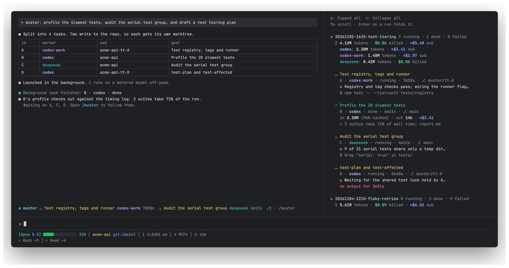

<div align="center">


# Muster

**One Claude Code session. A crew of CLI agents working in parallel. Every task's progress, tokens and cost in a live pane.**

[](https://github.com/jandyx/muster/actions/workflows/ci.yml)
[](LICENSE)
[](https://github.com/anthropics/claude-code)
[](https://www.python.org/)
[](#configure)

[Quick start](#quick-start) · [Agent setup](#set-up-with-any-coding-agent) · [Configure](#configure) · [The pane](#the-pane) · [Tokens and cost](#tokens-and-cost) · [How it works](docs/how-it-works.md) · [FAQ](#faq)

</div>

---

You talk to one Claude Code session. Claude splits the job, hands each piece to a worker (a Codex account, Claude Code on another backend such as DeepSeek), checks what comes back, and reports. Muster gives that loop a fixed shape so you stop re-explaining it every session, and puts a pane beside the chat that shows what every worker is doing right now and what it has cost.

<p align="center"></p>

<details>
<summary>The same pane as text</summary>

```text
▾ 20261105-1635-test-tiering  2 running · 4 done · 0 failed
  Σ 6.95M tokens · $0.35 billed · ≈$10.14 sub
    codex-work: 3.66M tokens · ≈$5.17 sub
    deepseek: 3.29M tokens · $0.35 billed

  ✓ Tiered tests: registry, tags and runner
    A · codex-work · done · 10m49s · ⎇ muster/tt-A
    in 3.65M (97% cached) · out 12k · ≈$5.17
    ↳ Registry, tag checks and migration list done; report.md

  … Tiered tests: test-plan and test-affected
    D · codex · running · 9m35s · ⎇ muster/tt-D
    ↻ Shell and executor tests pass; fixing the /var vs /private/var check, rerunning
    $ bash tests/run-runtime.sh tests/runtime/developer/developer-entry.test.mjs

▸ 20261105-1540-test-speed  0 running · 6 done · 0 failed
  Σ 19.60M tokens · $0.35 billed · ≈$11.50 sub
```

</details>

## Why Muster

Claude Code is a good planner and a careful reviewer. Codex accounts and cheaper Claude-compatible backends are good at grinding through well-scoped work. Running them together by hand means repeating the same instructions every session (which account takes which repo, how to isolate parallel edits, what to report) and switching terminals to see who is stuck.

Muster turns that into a habit Claude already knows and a screen you can glance at:

| | Without Muster | With Muster |
|---|---|---|
| Starting a batch | explain workers, accounts and rules again | say "muster: …" |
| Parallel edits to one repo | hope they don't collide | one git worktree per task, automatically |
| "Is it done? Is it stuck?" | switch terminals, read logs | live pane: latest note, latest command, stall warning |
| "What did that cost?" | guess | tokens and dollars per task, per worker, per run |
| Trusting the result | read every worker's claims | Claude checks the diffs and tests before reporting |

## Features

- **A `muster` skill.** Plan → isolate → self-contained prompts → launch in the background → verify → one report table. The same loop every time.
- **Any number of workers.** Each Codex account is a `codex` worker with its own `CODEX_HOME`; any Claude Code compatible CLI is a `claude` worker. Several tasks can run on one account at once.
- **Routing you write once.** Per-repo worker priority with quota fallbacks, workers fenced to certain repos, parallel caps. The fences and caps are enforced by the runner, not left to Claude's memory.
- **A live pane and band.** Task title, worker, elapsed time, the worker's latest note and command, a red warning after 2 minutes of silence, a one-line result, foldable runs — and the session's own Claude subagents, running first, finished ones folded.
- **Honest cost accounting.** Billed `$` for metered APIs, with DeepSeek's peak-hour price; API-equivalent `≈$` for Codex on a ChatGPT subscription; long-context pricing per request.
- **Session-bound.** A session sees only the runs it started; `claude --resume` brings them back.
- **No dependencies.** The runner is one Python file on the standard library.

## Quick start

**1. Install the plugin**

```text
/plugin marketplace add jandyx/muster
/plugin install muster@muster
```

**2. Let Claude set up your workers**

> set up muster

The `muster-setup` skill finds your Codex logins and Claude-compatible CLIs, asks which repos each one should take, writes `~/.muster/config.json` and checks it with `muster.py doctor`.

<details>
<summary>Or write the config by hand</summary>

```bash
mkdir -p ~/.muster
curl -fsSL https://raw.githubusercontent.com/jandyx/muster/main/examples/config.example.json -o ~/.muster/config.json
$EDITOR ~/.muster/config.json
python3 <plugin>/skills/muster/muster.py doctor
```

</details>

**3. Hand Claude a batch**

> muster: profile the slowest tests, audit the serial test group, and draft a tiering plan

Claude shows the plan table and starts, and the pane opens beside the chat. Reopen it any time with `/muster-panel`.

<details>
<summary>Install from a clone instead (runs straight from the folder; edit, then <code>/reload-plugins</code>)</summary>

```bash
git clone https://github.com/jandyx/muster ~/workspace/muster
claude plugin marketplace add ~/workspace/muster
claude plugin install muster@muster --scope user
```

</details>

### Set up with any coding agent

Paste this into Claude Code (or another agent with a shell) and it does the whole install:

```text
Install and configure Muster (https://github.com/jandyx/muster) for me:
1. Run: claude plugin marketplace add jandyx/muster && claude plugin install muster@muster --scope user
2. Run: python3 ~/.claude/plugins/marketplaces/muster/skills/muster/muster.py detect
   (if that path does not exist, find muster.py under ~/.claude/plugins)
3. Follow skills/muster-setup/SKILL.md from that repo: propose workers from what detect found,
   ask me only which repos each worker takes, write ~/.muster/config.json, then run muster.py doctor until it says ok.
4. Never print auth files or API keys. Tell me to run /reload-plugins when done.
```

**Requirements:** Claude Code with plugin support, Python 3.10+, and the worker CLIs you use (`codex`, `claude`, or a Claude-compatible wrapper).

## Configure

`~/.muster/config.json` (set `MUSTER_CONFIG` to use another path):

```jsonc
{
  "runsDir": "~/.muster/runs",                 // where every run is recorded
  "workers": {
    "codex":      { "type": "codex",  "codexHome": "~/.codex" },
    "codex-work": { "type": "codex",  "codexHome": "~/.codex-homes/work", "args": ["-m", "gpt-6-astra"] },
    "deepseek":   { "type": "claude", "command": "~/.local/bin/deepseek-claude",
                    "args": ["--dangerously-skip-permissions"], "billing": "metered" }
  },
  "routing": [                                  // first match on the task's cwd wins
    { "match": "~/workspace/work-*", "workers": ["codex-work", "codex", "deepseek"] },
    { "match": "*",                  "workers": ["codex", "deepseek"] }
  ],
  "only":  { "codex-work": ["~/workspace/work-*"] },   // this worker refuses any other repo
  "caps":  { "codex": 3, "claude": 5 },               // tasks at once per worker (by type or by name)
  "minFreeGB": 10,                                     // free disk a task needs to start; also per worker
  "preamble": ["Never print secrets or tokens in your output."]
}
```

Check it with `python3 <plugin>/skills/muster/muster.py doctor` (one line per problem, `ok` when usable), list workers with `workers`, and see what the machine offers with `detect`.

<details>
<summary>Worker types</summary>

| Type | Runs | Live progress from | Usage from |
|---|---|---|---|
| `codex` | `codex exec --dangerously-bypass-approvals-and-sandbox` with `CODEX_HOME=codexHome` | the agent's notes and `exec` lines in `log.txt` | the session rollout in `codexHome/sessions/` |
| `claude` | `<command> -p --output-format stream-json --verbose <args>` | the last text and tool call in `stream.jsonl` | the final `result` event's `modelUsage` |

</details>

<details>
<summary>What Claude follows vs. what the runner enforces</summary>

| Setting | Claude, when planning | `muster.py`, when launching |
|---|---|---|
| `routing` | picks workers in that order, falls back on quota errors | not checked |
| `only` | never plans a fenced worker elsewhere | refuses outside its globs (exit 3) |
| `caps` | passes each task its whole worker list | queues while every listed worker is full, starts on the first to free a slot (priority, then launch order); counts live processes only |
| `preamble` | adds the lines to every prompt | not checked |
| `minFreeGB` (default 10; a worker's own value wins) | — | will not start a task while the cwd's or `runsDir`'s volume has less free space (exit 4, `failed: disk low (…)`); checked again when a queued task gets its slot |

When a worker fails, `status` reads `failed: <reason>`: the last error line of its log (secrets such as `sk-…` or `Bearer …` masked, cut to 160 characters), or `exit <code>` when there is none. `meta` keeps it as `last_error`, with the log's path as `log_path`, and the pane shows both. A worker that ran out of disk shows `failed: disk full (ENOSPC), …` and its `result.md` ends with the command to rerun it.

</details>

## The pane

The pane opens by itself when a prompt starts with `muster:` or `/muster`. `/muster-panel` opens it and gives it the keyboard. While tasks run, a band above the prompt lists them.

Above the runs, **Claude agents** lists the subagents this Claude Code session spawned — the Agent tool's, including plugin agents such as `oh-my-claudecode:executor-high`. Running and waiting ones show with their status and, while they work, their latest tool call (`$ …`); finished ones fold into a count. The engine supplies the list (`$.agent.list()`), so they carry no worker, tokens or cost.

| Key | Does |
|---|---|
| `/muster-panel` | open and focus the pane |
| `ctrl+x`, then `tab` | move focus between the band and the pane |
| `↑` `↓` | scroll |
| `tab` · `enter` | move between runs · fold or unfold one |
| `e` · `c` | expand all · collapse all |
| `esc` | back to the prompt |

Finished runs fold to one line with their totals. A toast tells you when a task ends. Each worker keeps one color everywhere.

## Tokens and cost

- **Metered workers** (an API key, DeepSeek) show billed dollars in green, marked `peak` when they started in DeepSeek's peak hours (weekdays 01:00–04:00 and 06:00–10:00 UTC, double price). The skill warns before sending a large, non-urgent batch into peak hours.
- **Subscription workers** (Codex on a ChatGPT login) show `≈$`: what the same tokens would cost on the API. You are not billed per token.
- **Codex is priced per request**, so requests past the long-context threshold use the long-context rate.
- **Prices** live in [`prices.json`](prices.json) with their source and date. Override any model in `~/.muster/prices.json`.

The full decision chain is drawn in [docs/how-it-works.md](docs/how-it-works.md#how-a-tasks-cost-is-worked-out).

## How it works

Claude runs the `muster` skill, which calls `muster.py` once per task in the background. `muster.py` checks the fences and caps, starts the worker, writes everything under `runsDir`, and prices the usage when the worker exits. The pane reads those files every 5 seconds, and asks the engine for the session's own subagents on the same poll.

Architecture, a run's sequence, a task's states and what each pane row reads are drawn in **[docs/how-it-works.md](docs/how-it-works.md)**.

<details>
<summary>Where things are kept</summary>

| What | Where | Size, roughly |
|---|---|---|
| Runs: prompts, status, logs, results, usage | `runsDir` (`~/.muster/runs`) | 1–3 MB per run; `log.txt` is the bulk |
| Worker transcripts | each CLI's own folder (`codexHome/sessions`, the Claude profile's `projects`) | owned by those tools |
| Worktrees for parallel writers | next to the repo, branch `muster/<task>` | a full checkout each |

Muster deletes nothing on its own.

</details>

## Safety

> [!WARNING]
> Workers run with approvals and sandboxing off: they can run any command in the folder you give them. Use Muster in repos you trust, keep secrets out of prompts, and read the diffs before merging. Nothing is committed, pushed or merged unless you ask. `muster.py cancel` sends SIGTERM only to the runner pid in that task's `meta`, and only while that task is queued or running.

## FAQ

<details>
<summary><b>Does it work with oh-my-codex or other Codex wrappers?</b></summary>

Workers run plain `codex exec`, which still loads the worker's `codexHome` (its `AGENTS.md`, config and skills). Runtime hooks that a wrapper adds around interactive sessions do not run.

</details>

<details>
<summary><b>Can I use it without Codex?</b></summary>

Yes. Configure only `claude` workers: Claude Code on another backend, or any CLI that accepts `-p --output-format stream-json`.

</details>

<details>
<summary><b>Why is a task "failed: refused"?</b></summary>

The runner stopped it before it started: exit 3 means every worker it was given is fenced away from that repo (`only`). A worker at its parallel cap (`caps`) does not refuse; the task shows `queued` until a slot frees.

</details>

<details>
<summary><b>A task shows "canceled", "failed: lost" or "failed: interrupted".</b></summary>

`canceled`: Claude stopped it on purpose with `muster.py cancel` (superseded, no longer needed), or a task it runs `--after` failed; not counted as a failure. `interrupted`: the runner was told to stop (SIGTERM, SIGHUP, Ctrl-C); it stopped the worker and recorded that. `lost`: the runner process is gone without writing a final status (killed with SIGKILL, a crash, a reboot), so the pane marks it instead of showing a `running` that never ends. Read the task's `log.txt` or `stream.jsonl` for what the worker got done. Editing `muster.py` while tasks run is safe: Python reads the whole file at start.

</details>

<details>
<summary><b>I resumed a session and the pane is empty.</b></summary>

Runs are tied to the session id that started them. `claude --resume` keeps the id; `--fork-session` and `/clear` start a new one, so earlier runs stay on disk but leave the pane.

</details>

## Limits

- The peak or off-peak price is chosen by a task's start time; public holidays are not modelled.
- `≈$` is an estimate of API cost, not what a subscription charges.
- While a `claude` worker is thinking, its `↻` note stays on the previous line.
- A Claude agent's latest tool call is kept in memory: a plugin reload forgets it until that agent calls another tool.
- The pane shows the last 30 runs of the current session.

## Contributing

Issues and pull requests are welcome. Coding agents: read [AGENTS.md](AGENTS.md) first. Before sending a change:

```bash
claude plugin validate .                  # manifest, hooks module, marketplace
claude plugin test .                      # pane and band
python3 -m unittest discover -s tests     # runner, pricing, fences and caps
```

## License

[MIT](LICENSE) © jandyx
