# Design

Why Muster is built the way it is. [How it works](how-it-works.md) draws the parts; this page explains the choices behind them and what each one gives up.

## Principles

1. **Claude decides, workers execute.** Claude Code plans, writes each brief, reviews and reports. Codex accounts and Claude-compatible backends do well-scoped work. Judgment stays with the model that has the user's context; volume goes to cheaper or separately billed workers.
2. **Evidence over claims.** A worker's "tests pass" is a claim. The runner records what changed (`changes.diff`), runs the done check itself (`check.txt`) and flags edited tests (`tests_touched`). A task counts as Done only when `review.md` approves that exact diff (`changes-sha256`).
3. **Hard limits in code, judgment in the skill.** What must never happen is enforced by `muster.py`. What needs taste is written in `SKILL.md` for Claude to follow.
4. **Files are the interface.** The runner and the pane share nothing but files in a task folder. Either side can be rewritten, restarted or inspected with `cat`.
5. **Nothing irreversible by default.** Muster never commits, pushes, merges or deletes on its own. `clean` lists commands; the user runs them.
6. **No dependencies.** The runner is one Python file on the standard library, and prices ship with the plugin. Nothing is installed or fetched while tasks run.

## Who enforces what

```mermaid
flowchart LR
    subgraph skill["SKILL.md: Claude follows"]
        routing["routing order and fallbacks"]
        preamble["preamble lines in every brief"]
        tierpick["which tier a task gets (rubric or tiers.*.when)"]
        review["review against the brief, review.md"]
        escalate["when to escalate a tier"]
    end
    subgraph runner["muster.py: enforced"]
        only["only: refuses fenced repos (exit 3)"]
        caps["caps: queues over the limit"]
        tierapply["tier prefer and args"]
        check["--check: fails the task"]
        evidence["changes.diff, tests_touched, shared_with"]
        failure["failure kind in meta"]
    end
    subgraph pane["Pane: shows"]
        state["Needs review / Needs fixes / Done"]
        reminder["Stop hook: sends the session back to unreviewed work"]
    end
    skill --> runner --> pane
```

The split follows one test: could a mistake here lose data, leak work into the wrong repo or overspend? Then code enforces it. Is it a judgment about quality or fit? Then the skill describes it and the pane makes skipping it visible.

## Decisions

### A task folder, not a database or a socket
Each task is a folder with `prompt.md`, `meta` (key=value), `status`, a log, `result.md`, `usage`, `changes.diff`, `check.txt` and `review.md`. The runner writes everything except `review.md`, which Claude writes; the pane only reads. Plain files survive crashes, need no server and let a person debug a run with a text editor. The cost is a contract: a change to any of these files is a change to both sides, so [AGENTS.md](../AGENTS.md) lists them.

### Review is bound to the diff
`review.md` must carry the `changes_sha256` from `meta`. A review of an older diff stops counting the moment the diff changes, so a fix round cannot inherit an approval. The pane keeps unapproved work out of Done, and the progress bar fills only with accepted work, because a finished worker is not finished work.

### The change must not grade itself
Claude reads changed tests and check scripts first: a weakened assertion or a skipped test is Critical unless the brief asked for it. Large diffs go to a fresh reviewer that never saw the author's reasoning. The value of that reviewer comes from not sharing the author's context, not from a stronger model.

### Retries are one piece of work
A rerun launched with `--retry-of` joins the attempt it replaces, across ids and runs, and the newest attempt decides, as a CI retry does. Without this, every fix round added a task to the total, so progress looked worse the more carefully work was checked.

### Tiers are explicit, not learned
Model routers and cascades in the research literature learn from single-turn benchmarks with large volumes. Muster's tasks are multi-step and far fewer, too few to train on and too different to borrow from. So a task gets one of three named tiers chosen by Claude from a written rubric (or the user's `when`), and the config maps each tier to workers (`prefer`) and CLI arguments (`args`). `stats` reports what each tier delivered so a person can adjust the mapping.

### Only task failures escalate
A failure records why: `task` (failed done check), `blocked` (the brief lacks something), `provider` (quota, rate limit, auth), `infra` (disk, network, crash) or `interrupted`. Only a task failure can say the tier was too weak, and even then a narrow fix keeps its tier. The rest rerun at the same tier: a stronger model does not fix a full disk or a missing answer.

### Prices are a snapshot
Costs are computed when a task ends, from `prices.json` plus the user's `~/.muster/prices.json`. Subscription work shows `≈$`, the API-equivalent, so accounts can be compared even when no money changes hands. Fetching prices at run time would add a network call and a failure mode to every task.

### The session owns its runs
Runs record the session that started them. The pane shows that session's runs, and when a turn ends with finished work still unreviewed, a Stop hook sends that same session back once per task. Reviewing is the dispatching session's job; nothing else would remind it.

## Trade-offs we accept

- Workers run with approvals and sandboxing off. Isolation comes from worktrees, fences and review, not from a sandbox (see the README's Safety section).
- `changes.diff` cannot tell a worker's edits from a person's edits in the same repo during a run.
- The tier rubric and escalation are followed by Claude, not checked by the runner. A wrong tier costs money or a retry, not data.
- Peak pricing is chosen by a task's start time; holidays are not modelled.
