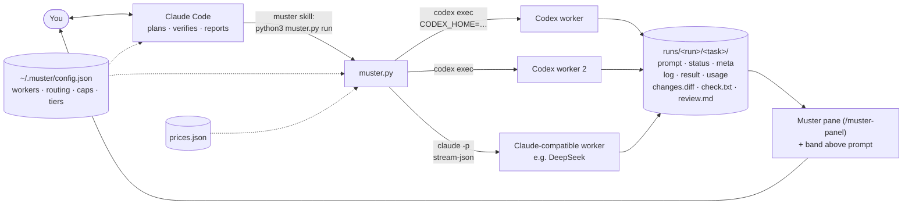
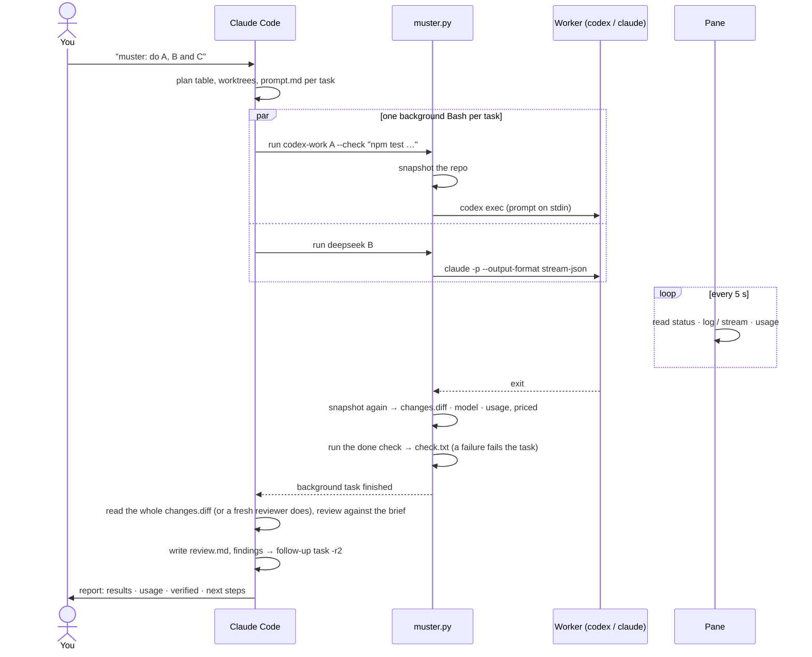
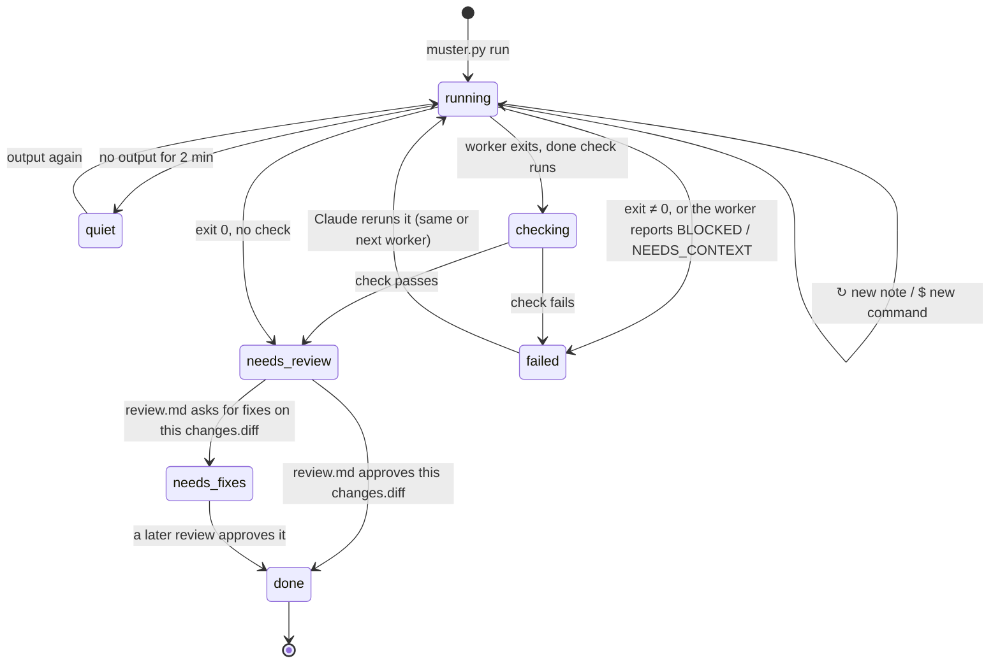
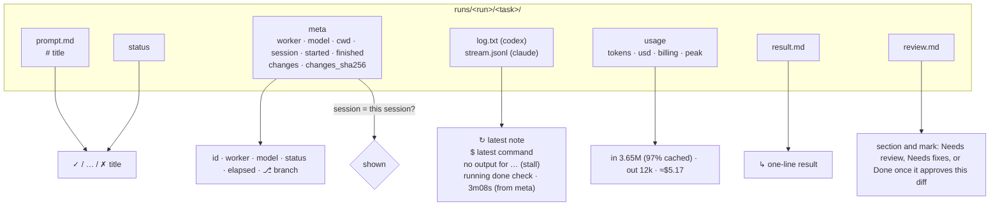
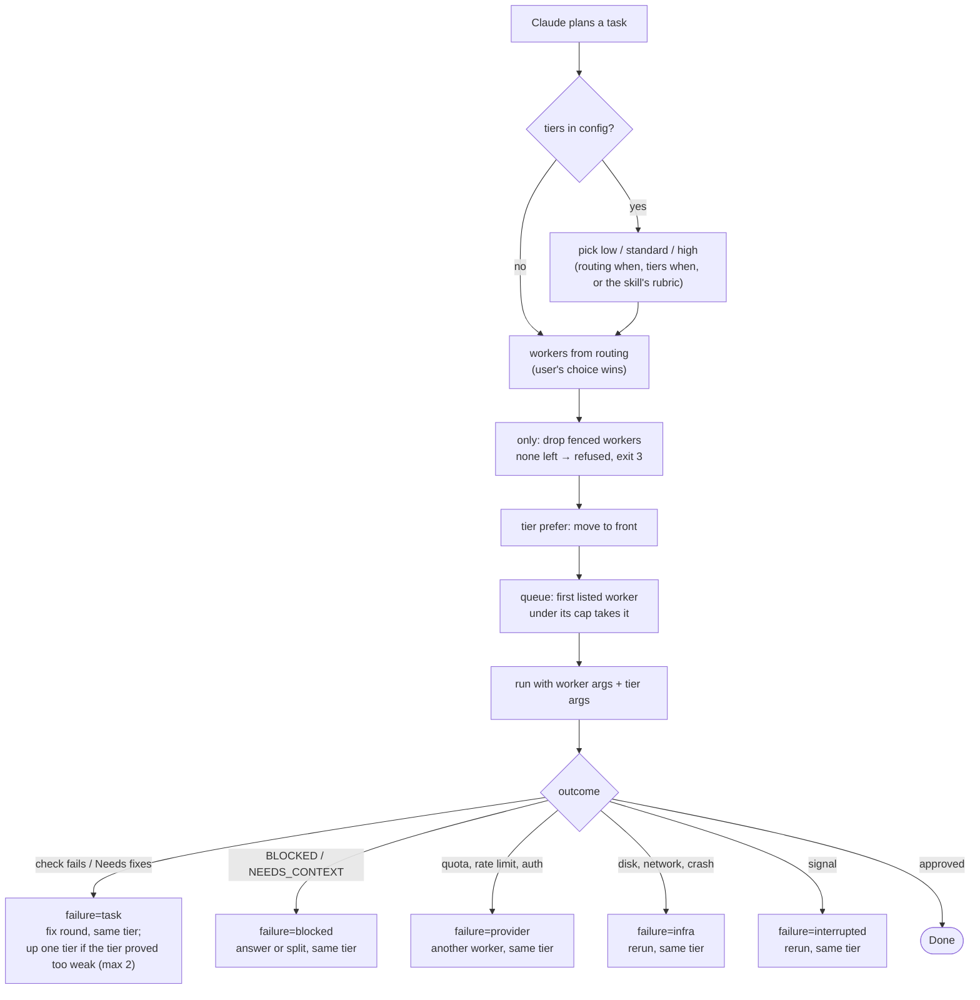
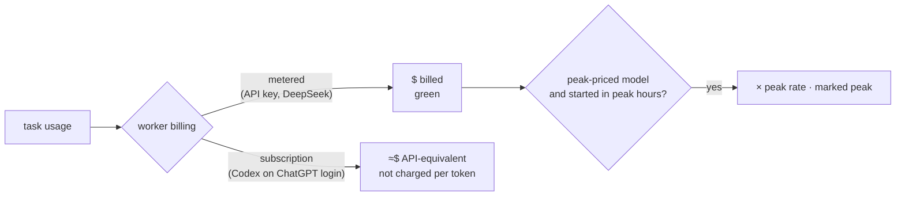

# How Muster works

Diagrams of the moving parts. The [README](../README.md) covers install, config and use; [Design](design.md) explains why it is built this way.

## Architecture

One run, start to finish:

A task's life, as the pane shows it:

What the pane reads for each task:

## How a task gets its worker, and what happens when it fails

Provider, infra and interrupted failures do not count toward the three-round limit (the first run and two fixes); after three failed rounds, Claude switches to a stronger worker, does it itself or asks. Two failures outside the task in a row on one piece of work also stop the reruns and go to the user, and a context or turn limit counts as a task failure.

## How a task's cost is worked out

Prices come from [`prices.json`](../prices.json), overridden by `~/.muster/prices.json`.
