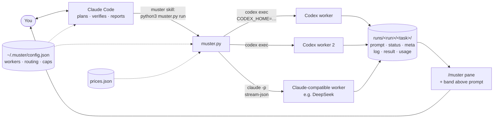
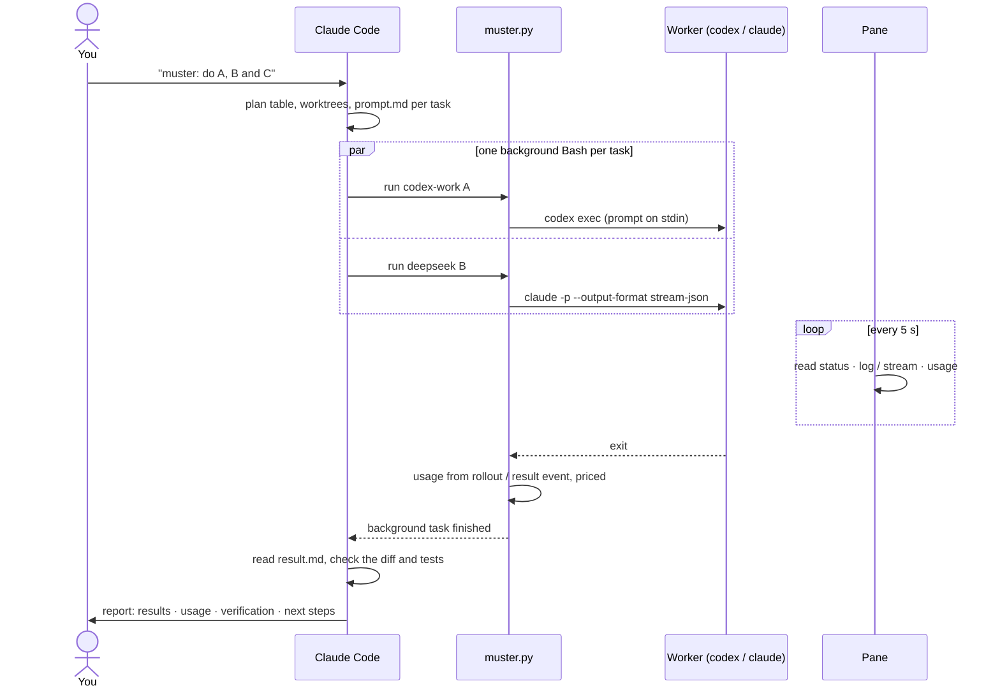
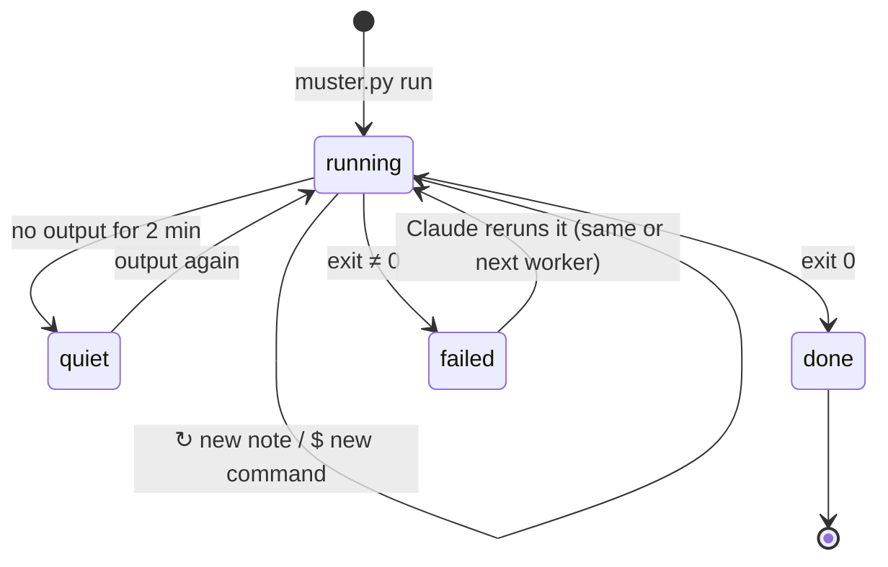
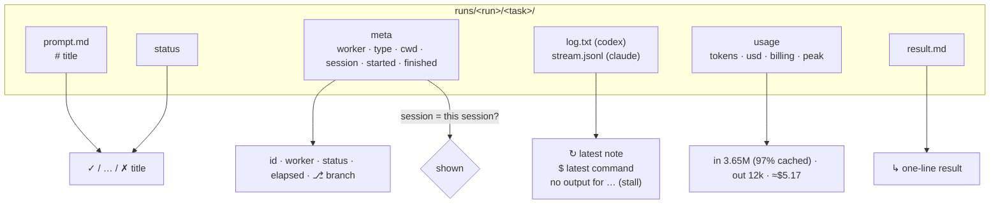
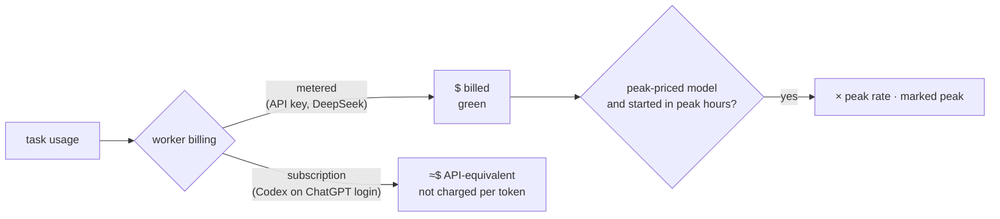

# How Muster works

Diagrams of the moving parts. The [README](../README.md) covers install, config and use.

## Architecture

One run, start to finish:

A task's life, as the pane shows it:

What the pane reads for each task:

## How a task's cost is worked out

Prices come from [`prices.json`](../prices.json), overridden by `~/.muster/prices.json`.
